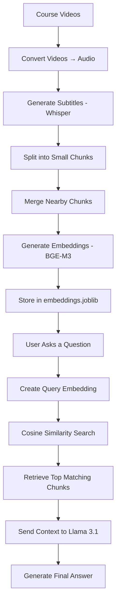

# 📚 Sigma Web Development Course AI Assistant (RAG)


An AI-powered question-answering system for the **Sigma Web Development Course**, built with **Retrieval-Augmented Generation (RAG)**.

Instead of scrubbing through hours of video, ask questions in plain English and get pointed straight to the right lecture, timestamp, and summary:

- "Where is HTML taught?"
- "Which video explains CSS selectors?"
- "Where are JavaScript functions discussed?"
- "When are Flexbox and Grid introduced?"

The system retrieves the most relevant course sections using **vector embeddings** and generates human-like answers with a local **LLM (Llama 3.1)** running through **Ollama** — fully offline, no API keys required.

---

## 📑 Table of Contents

- [Features](#-features)
- [Project Workflow](#️-project-workflow)
- [Project Structure](#-project-structure)
- [Technologies Used](#️-technologies-used)
- [How It Works](#-how-it-works)
- [Installation](#-installation)
- [Usage](#️-usage)
- [Sample Output](#-sample-output)
- [Future Improvements](#-future-improvements)
- [Author](#-author)

---

## 🚀 Features

| Feature | Description |
|---|---|
| 🗣️ Natural Language Queries | Ask questions the way you'd ask a person |
| 🔍 Semantic Search | Finds meaning, not just keyword matches |
| 🎯 Precise Retrieval | Surfaces the most relevant course sections |
| ✍️ AI-Generated Summaries | Concise, human-readable answers |
| 🎬 Rich Metadata | Returns video number, title, timestamp & explanation |
| 🔌 Fully Offline | Runs locally via Ollama — no external API calls |
| ⚡ Fast Search | Vector similarity search using cosine similarity |

---

## 🏗️ Project Workflow



---

## 📂 Project Structure

```
RAG-based-ai/
│
├── videos/                    # Raw course video files
├── audios/                    # Extracted audio from videos
├── jsons/                     # Raw subtitle/chunk data
├── merged_jsons/               # Merged, context-rich chunks
│
├── preprocess_json.py         # Generates embeddings from merged chunks
├── merge_chunks.py            # Merges nearby subtitle chunks
├── process_incomingQuery.py   # Handles user queries & retrieval
│
├── embeddings.joblib          # Stored vector embeddings
├── prompt.txt                 # Prompt template sent to the LLM
├── response.txt               # Last generated response (log)
│
├── requirements.txt           # Python dependencies
└── README.md                  # Project documentation
```

---

## ⚙️ Technologies Used

- **Python** — core language
- **Pandas / NumPy** — data handling
- **Scikit-Learn** — cosine similarity computation
- **Joblib** — embedding storage/serialization
- **Requests** — API calls to local Ollama server
- **Whisper** — speech-to-text subtitle generation
- **Ollama** — local LLM runtime
- **BGE-M3** — embedding model
- **Llama 3.1 (8B)** — response generation

---

## 🧠 How It Works

### 1. Subtitle Generation
Course videos are transcribed into subtitles using **Whisper**.

```
Video 1
00:15 - 00:20
Today we will learn HTML.
```

### 2. Chunking
Subtitles are split into small, manageable chunks for embedding.

### 3. Chunk Merging
Nearby chunks are merged so the LLM receives complete ideas rather than isolated, fragmented sentences — this significantly improves answer quality.

### 4. Embedding Generation
Each merged chunk is converted into a vector embedding using **BGE-M3** and stored in `embeddings.joblib`.

### 5. User Query
The user's natural-language question is converted into an embedding using the same model.

### 6. Similarity Search
Cosine similarity compares the query embedding against every stored chunk embedding to find the closest matches.

### 7. AI Response
The most relevant chunks are passed as context to **Llama 3.1**, which generates a clean, structured answer:

```
Video Number: 2
Video Title: Your First HTML Website
Time: 00:36 - 01:12

Summary:
This section introduces HTML websites and explains how HTML
works together with CSS and JavaScript.
```

---

## 📦 Installation

### 1. Clone the repository
```bash
git clone https://github.com/yourusername/RAG-based-ai.git
cd RAG-based-ai
```

### 2. Install Python dependencies
```bash
pip install -r requirements.txt
```

### 3. Install Ollama
Download from [ollama.com](https://ollama.com), then pull the required models:

```bash
ollama pull llama3.1:8b
ollama pull bge-m3
```

### 4. Start the Ollama server
```bash
ollama serve
```

---

## ▶️ Usage

### Step 1 — Generate embeddings
Process the course transcripts and build the embedding store:
```bash
python preprocess_json.py
```

### Step 2 — Ask questions
Launch the query interface:
```bash
python process_incomingQuery.py
```

Example session:
```
Ask a Question: Where is HTML taught?

Video Number: 2
Video Title: Your First HTML Website
Time: 00:36 - 01:12

Summary:
This section introduces HTML websites and explains how HTML
works together with CSS and JavaScript.
```

---

## 📸 Sample Output

**Question**
```
Where is HTML taught?
```

**Answer**
```
Video Number: 2
Video Title: Your First HTML Website
Time: 00:36 - 01:12

Summary:
This section introduces HTML websites and explains how HTML
works together with CSS and JavaScript.
```

---

## 📈 Future Improvements

- [ ] FAISS vector database integration
- [ ] ChromaDB support
- [ ] Streamlit web interface
- [ ] Persistent chat history
- [ ] Multi-course support
- [ ] PDF document support
- [ ] Hybrid search (BM25 + embeddings)
- [ ] Improved reranking
- [ ] Response streaming
- [ ] Source confidence scores

---

## 👨‍💻 Author

**Vedant Boddula**
Information Technology Student · Data Scientist · AI Enthusiast · RAG Systems

· [LinkedIn](https://linkedin.com/in/vedant-boddula)

---

⭐ If you found this project useful, consider giving it a star — it helps others discover it too!

# HOW TO USE THIS RAG AI teaching Assistant on your data

# step 1-Collect videos
Move all your videos to videos folder

# step 2-Convert to mp3
Convert all the videos to mp3 by running vid_to_mp3.py

# step 3-Covert mp3 to json
Convert all the mp3 files to json by running mp3_to_json.py

# step 4-Convert the json files to Vectors
Use the file preprocess_json to convert the json files to a dataframe with embeddings and save it as a joblib pickle

# step 5-Prompt generation and feeding to LLM
Read the joblib file and load it into the memory. Then create a relevant prompt as per the user query and feed it to the  LLM

